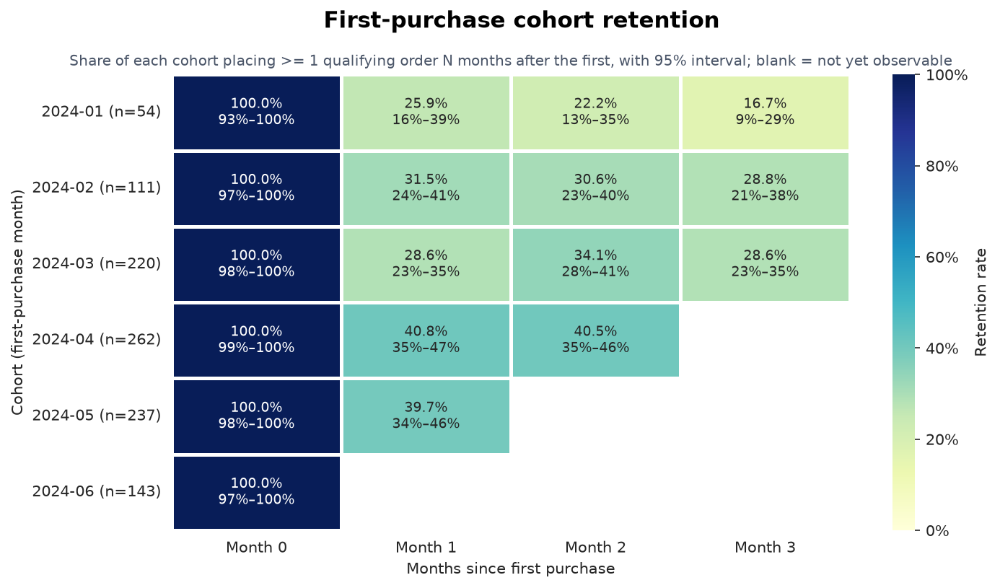
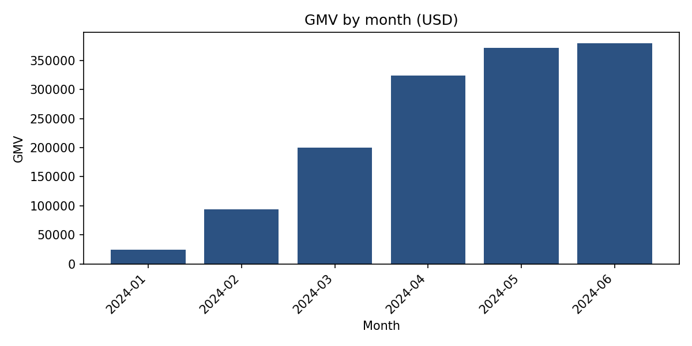
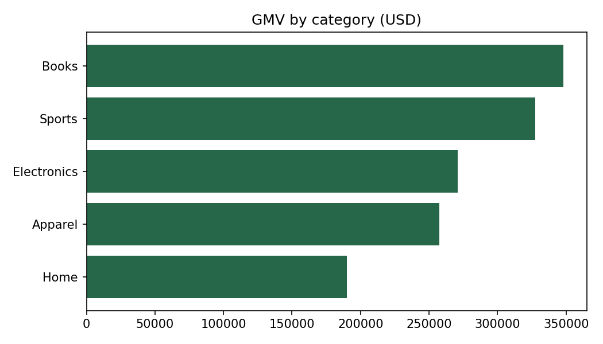
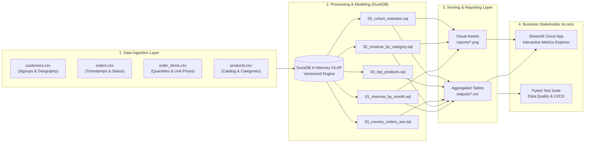

# 🛒 Retail Metrics & Customer Cohort Analytics

> **An end-to-end Data Analytics & Analytics Engineering portfolio project featuring DuckDB OLAP modeling, automated ETL reporting, customer cohort retention analysis, and an interactive Streamlit application.**

[](https://github.com/lllexalllepexa/portfolio-retailmetrics/actions)
[](https://lllexalllepexa-test1.streamlit.app/)


🇷🇺 **[Перейти к русской версии (README.ru.md)](README.ru.md)**

---

## 🚀 Live Interactive Dashboard

Explore the interactive web application deployed on Streamlit Community Cloud:

[](https://lllexalllepexa-test1.streamlit.app/)

👉 **Direct Link:** [https://lllexalllepexa-test1.streamlit.app/](https://lllexalllepexa-test1.streamlit.app/)

The web app allows business stakeholders to interactively inspect precomputed SQL datasets, monitor executive KPI scorecards, and review visual reports across revenue cohorts, categories, and geographic markets.

---

## 📌 Executive Summary & Business Challenge

In an international B2C e-commerce business operating across five key markets (United States, United Kingdom, Germany, France, and Poland), executive leadership required transparency into **revenue trajectory**, **product mix**, **geographic efficiency**, and **customer retention dynamics**.

### Strategic Business Questions:
1. **Growth Velocity**: How fast is Gross Merchandise Value (GMV) expanding month-over-month, and is growth driven by order volume or order value?
2. **Category Performance**: Which product categories generate the highest net revenue after accounting for customer returns?
3. **Cross-Border Consistency**: Does Average Order Value (AOV) vary across international territories, or is basket purchasing power uniform?
4. **Cohort Stickiness**: Are newly acquired customers developing long-term purchasing habits, or does customer retention degrade sharply after Month 0?

To answer these questions, an automated analytical pipeline was constructed using an in-memory **DuckDB OLAP engine**, structured SQL analytical models with Common Table Expressions (CTEs), automated chart generation, and an interactive Streamlit dashboard.

---

## 📊 Key Analytical Insights (Quantified)

| Metric Area | Key Finding | Business Impact |
|---|---|---|
| **GMV Trajectory** | **~15x Expansion** ($24.6K in Jan 2024 $\rightarrow$ $379.4K in Jun 2024) | Rapid top-line growth driven by surging order volume (from 41 to 569 monthly completed orders). Total H1 2024 GMV reached **$1,393,065**. |
| **Category Leadership** | **Books ($347.9K)** & **Sports ($327.6K)** dominate GMV | Books and Sports represent **48.5%** of total net sales. High net unit volume (2,020 units in Sports, 1,833 in Books) confirms core product-market fit. |
| **Cross-Country AOV** | **Uniform Basket Sizes** across borders (~$640 – $678 AOV) | While the US represents the primary volume driver (977 orders, $653.0K GMV), European markets show consistent AOV: **GB ($678.05)**, **FR ($655.93)**, **DE ($648.58)**, and **PL ($640.89)**. |
| **Cohort Retention** | **Peak Month 1 Retention of 61.3%** (April 2024 Cohort) | April signups achieved exceptional M1 repeat purchase rates (61.3%), while baseline retention across cohorts stabilizes at a healthy **35%–45%** through Month 3. |

---

## 📈 Visualizations & Analytical Deep-Dives

### 1. Customer Cohort Retention Heatmap
Tracks monthly customer signup cohorts through subsequent activity months (Month 0 to Month 3 offset). Each cell represents the percentage of eligible cohort members who completed at least one qualifying order in that month.



> **Key Takeaway**: The **April 2024** cohort demonstrated significant acceleration in Month 1 engagement (**61.3%** vs 34.4% in Jan and 45.8% in Feb), indicating that spring promotional or onboarding campaigns successfully catalyzed early second-order transactions.

---

### 2. GMV Growth Trajectory (Monthly)
Month-over-month Gross Merchandise Value (net of partial/full returns) from fulfilled customer orders.



> **Key Takeaway**: Consistent compounding growth throughout Q1 and Q2 2024, stabilizing at ~$370K–$380K/month in May and June as operational capacity scaled.

---

### 3. GMV Contribution by Product Category
Total net revenue earned across all five product catalog verticals.



> **Key Takeaway**: Balanced catalog demand with clear revenue concentration: **Books** ($347.9K), **Sports** ($327.6K), **Electronics** ($271.0K), **Apparel** ($257.4K), and **Home** ($189.9K).

---

## 🏗️ Data Architecture & Pipeline Flow

The project follows modern Analytics Engineering design principles: modular SQL queries, in-memory OLAP data processing, deterministic synthetic data generation, and CI/CD automated validation.



---

## 🗄️ Analytics SQL Catalog

All queries are written in standard ANSI SQL optimized for DuckDB execution:

| # | Query File | Analytical Focus | Core SQL Concepts |
|:---:|---|---|---|
| **01** | [`sql/01_revenue_by_month.sql`](sql/01_revenue_by_month.sql) | **Monthly Revenue & Volume**<br/>Computes total monthly GMV and unique order count. | `strftime()`, `sum()`, `count(DISTINCT)`, `WHERE status IN ('completed', 'returned')` |
| **02** | [`sql/02_revenue_by_category.sql`](sql/02_revenue_by_category.sql) | **Category Breakdown**<br/>Aggregates net revenue and units sold accounting for item returns. | Multi-table joins (`orders`, `order_items`, `products`), aggregate net calculation |
| **03** | [`sql/03_country_orders_aov.sql`](sql/03_country_orders_aov.sql) | **Geographic Mix & AOV**<br/>Evaluates order volume, revenue, and average basket size per country. | Common Table Expressions (CTE), `nullif()` division safeguards, order-level aggregation |
| **04** | [`sql/04_top_products.sql`](sql/04_top_products.sql) | **Top Performing SKUs**<br/>Identifies top 15 revenue-generating items. | `GROUP BY`, `ORDER BY gmv_usd DESC`, `LIMIT 15` |
| **05** | [`sql/05_cohort_retention.sql`](sql/05_cohort_retention.sql) | **Customer Cohort Retention Matrix**<br/>Calculates customer retention across signup cohorts for Month offsets 0–3. | Multi-stage CTEs (`signup`, `eligible`, `activity`, `with_offset`, `cohort_sizes`), `date_trunc()`, `date_diff()` |

---

## 📐 Business Metric Definitions & Logic

- **Gross Merchandise Value (GMV)**:
  $$\text{GMV} = \sum (\text{quantity} - \text{quantity\_returned}) \times \text{unit\_price\_paid}$$
  *Calculated only across orders with status `completed` or `returned`. Orders flagged as `cancelled` are strictly excluded. Partial item returns are deducted from line-level totals.*

- **Average Order Value (AOV)**:
  $$\text{AOV} = \frac{\text{Total GMV}}{\text{Distinct Qualifying Orders Count}}$$

- **Cohort Month**:
  $$\text{Cohort Month} = \text{date\_trunc}('month', \text{customer signup date})$$

- **Retention Rate**:
  $$\text{Retention Rate}_{c, n} = \frac{\text{Unique Customers in Cohort } c \text{ with } \ge 1 \text{ Qualifying Order in Month } (c + n)}{\text{Total Qualifying Customers in Cohort } c}$$
  *(Evaluated across calendar month offsets $n \in [0, 3]$).*

---

## 📁 Repository Structure

```text
portfolio-retailmetrics-audit/
├── .github/
│   └── workflows/
│       └── ci.yml                # GitHub Actions automated test & build pipeline
├── data/                         # Source transactional datasets (CSV)
│   ├── customers.csv             # Customer IDs, signup dates, country codes
│   ├── orders.csv                # Order timestamps, customer references, statuses
│   ├── order_items.csv           # Line items, quantities, prices, return counts
│   └── products.csv              # Product catalog, categories, list prices
├── outputs/                      # Output datasets generated by SQL pipeline
│   ├── 01_revenue_by_month.csv
│   ├── 02_revenue_by_category.csv
│   ├── 03_country_orders_aov.csv
│   ├── 04_top_products.csv
│   └── 05_cohort_retention.csv
├── reports/                      # High-resolution visualization artifacts (PNG)
│   ├── cohort_retention_heatmap.png
│   ├── gmv_by_category.png
│   └── gmv_by_month.png
├── scripts/
│   ├── generate_data.py          # Deterministic synthetic data generator (seed=42)
│   └── plot_cohort_heatmap.py   # Seaborn/Matplotlib cohort heatmap generator
├── sql/                          # Production analytical SQL queries
│   ├── 01_revenue_by_month.sql
│   ├── 02_revenue_by_category.sql
│   ├── 03_country_orders_aov.sql
│   ├── 04_top_products.sql
│   └── 05_cohort_retention.sql
├── src/
│   └── run_pipeline.py           # Pipeline orchestrator (DuckDB execution & charting)
├── tests/
│   └── test_pipeline_and_data.py # Automated test suite (schemas, integrity, invariants)
├── requirements.txt              # Project dependencies
├── streamlit_app.py              # Interactive Streamlit analytics web application
├── README.ru.md                  # Russian version of the documentation
└── README.md                     # Main project documentation (English)
```

---

## ⚡ Quickstart & Local Setup

### 1. Prerequisites
- Python **3.11** (or compatible 3.10+)
- `git`

### 2. Clone and Setup Environment
```bash
git clone https://github.com/lllexalllepexa/portfolio-retailmetrics.git
cd portfolio-retailmetrics

# Create virtual environment
python -m venv .venv

# Activate virtual environment
# On Windows (PowerShell):
.venv\Scripts\Activate.ps1
# On macOS / Linux:
source .venv/bin/activate

# Install dependencies
pip install -r requirements.txt
```

### 3. Run the Analytical Pipeline
Execute the pipeline to load CSV data into DuckDB, run all SQL transformations, and regenerate output CSVs and charts:
```bash
python src/run_pipeline.py
```

### 4. Launch the Interactive Streamlit App
```bash
streamlit run streamlit_app.py
```
*Access the local web dashboard at `http://localhost:8501`.*

### 5. Run Automated Tests
Run the comprehensive test suite verifying data integrity, schema consistency, SQL execution, and chart outputs:
```bash
pytest -v
```

### 6. (Optional) Regenerate Synthetic Data
To generate a clean synthetic dataset with deterministic random seed (`seed=42`):
```bash
python scripts/generate_data.py
python src/run_pipeline.py
```

---

## 🛠️ Technology Stack & Engineering Standards

- **OLAP Engine**: [DuckDB](https://duckdb.org/) (High-performance in-process analytical SQL)
- **Programming & Scripting**: Python 3.11+, Pandas, NumPy
- **Visual Analytics**: Matplotlib, Seaborn
- **Stakeholder Presentation**: [Streamlit](https://streamlit.io/) Cloud
- **Automated Testing**: Pytest (schema validation, foreign key checks, non-negative invariants)
- **Continuous Integration**: GitHub Actions CI (`ci.yml`)

---

## 👤 Author & Contact

**Aleksei** — Analytics Engineer / Data Analyst
- **Live Demo**: [Streamlit Cloud Dashboard](https://lllexalllepexa-test1.streamlit.app/)
- **GitHub**: [@lllexalllepexa](https://github.com/lllexalllepexa)
- **Repository**: [portfolio-retailmetrics](https://github.com/lllexalllepexa/portfolio-retailmetrics)
