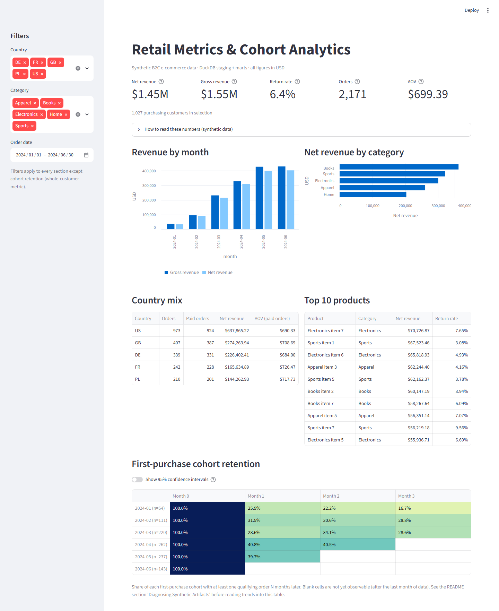
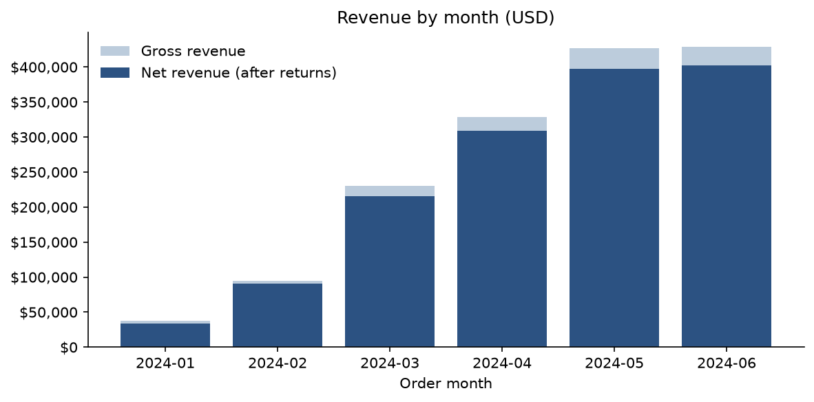
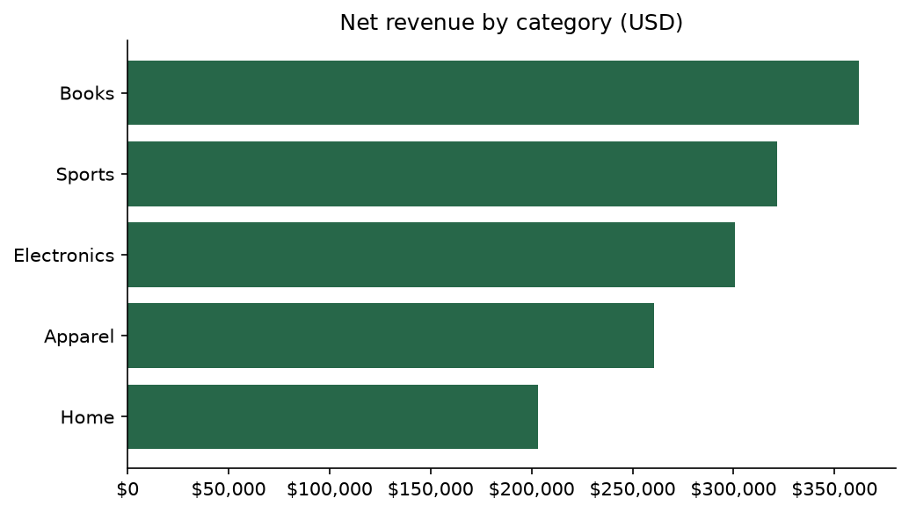
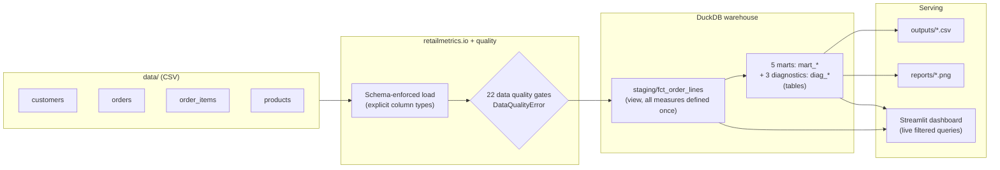

# Retail Metrics & Customer Cohort Analytics

> A small, end-to-end analytics engineering project: raw CSVs → schema-enforced DuckDB load → data quality gates → a staging fact model → five SQL marts → charts and an interactive Streamlit dashboard, with golden-fixture tests and a one-command check.

[](https://lllexalllepexa-test1.streamlit.app/)


**[Русская версия (README.ru.md)](README.ru.md)** · **[Live dashboard](https://lllexalllepexa-test1.streamlit.app/)** (sleeps when idle; the first load can take about a minute)



> [!IMPORTANT]
> **All data is synthetic.** It is produced by [`scripts/generate_data.py`](scripts/generate_data.py) (seed 42) from deliberately simple distributions. The numbers below demonstrate the pipeline and the metric definitions; they are not findings about real customers. Several apparent trends are artifacts of the generator — see [Diagnosing Synthetic Artifacts](#diagnosing-synthetic-artifacts).

---

## Business questions

The scenario is a B2C e-commerce store selling in five markets (US, GB, DE, FR, PL), January–June 2024.

1. **Growth** — How is monthly net revenue developing, and is it driven by order volume or order value?
2. **Category mix** — Which categories generate the most net revenue after returns, and where are returns concentrated?
3. **Markets** — Does average order value differ between countries?
4. **Retention** — What share of customers buy again in the months after their first purchase?

## Results on the synthetic dataset

| Area | Result | Read with |
|---|---|---|
| Totals (H1 2024) | **$1,448,429.39 net revenue** from $1,546,683.95 gross (6.35% returned by value); 2,171 qualifying orders from 1,027 purchasing customers; 116 cancelled orders excluded | — |
| Growth | Net revenue rises from $34.1K (Jan, 60 orders) to $402.1K (Jun, 582 orders), ~11.8x | [Artifact 1](#1-growth-is-a-cumulative-customer-base-not-momentum) |
| Category mix | Books ($362.2K) and Sports ($321.7K) are 47.2% of net revenue; return rates range 5.2% (Apparel) – 7.2% (Books) | Products are assigned uniformly at random, so ranking reflects price draws |
| Markets | AOV (net revenue / paid orders): FR $726, PL $718, GB $709, US $690, DE $684 — **all 95% CIs overlap** (±$30–67, [`country_aov_ci.csv`](outputs/diagnostics/country_aov_ci.csv)) | [Artifact 3](#3-country-aov-differences-are-noise) |
| Retention | Month 1 retention: Jan cohort 25.9% (95% CI 16–39%, n = 54), Feb 31.5%, Mar 28.6%, **Apr 40.8% (35–47%)**, May 39.7% | [Artifact 2](#2-later-cohorts-look-stickier-because-their-orders-are-compressed) |

Exact figures live in [`outputs/`](outputs/), and every number in this README, including the diagnostics below, comes from a committed query. The test suite regenerates all outputs from scratch and fails if they differ from the committed files.

### Charts


| | |
|---|---|
|  |  |

---

## Diagnosing Synthetic Artifacts

A dashboard will happily display any pattern in its input. Before attributing a trend to customer behavior, it is worth asking whether the data-generating process could have produced it by itself. Here, it does — for the three most "insightful-looking" results.

**How the generator works:** 1,200 customers sign up uniformly between Jan 1 and **Apr 30**. Each customer independently draws **0–5 orders (mean ≈ 1.8)**, with order dates uniform between their signup date and **Jun 30**. Country, products, discounts and statuses are drawn independently of everything else.

### 1. Growth is a cumulative customer base, not momentum

Source: [`sql/diagnostics/monthly_activity.sql`](sql/diagnostics/monthly_activity.sql) → [`outputs/diagnostics/monthly_activity.csv`](outputs/diagnostics/monthly_activity.csv)

| Month | New signups | Cumulative signups | Active buyers | Orders | Net revenue / order |
|---|---:|---:|---:|---:|---:|
| 2024-01 | 295 | 295 | 54 | 60 | $568 |
| 2024-02 | 288 | 583 | 125 | 138 | $655 |
| 2024-03 | 324 | 907 | 267 | 319 | $676 |
| 2024-04 | 293 | 1,200 | 368 | 468 | $661 |
| 2024-05 | 0 | 1,200 | 467 | 604 | $658 |
| 2024-06 | 0 | 1,200 | 450 | 582 | $691 |

Revenue per order is flat; the entire increase is order volume, and volume tracks the number of customers who have already signed up and still have orders "left to place". The plateau in May–June is simply where signups stop. Nothing about demand, marketing or operations is encoded in the data, so none of it can be inferred.

### 2. Later cohorts look stickier because their orders are compressed

Every customer gets the same order-count distribution regardless of how much of the window remains ([`sql/diagnostics/signup_cohorts.sql`](sql/diagnostics/signup_cohorts.sql)):

| Signup month | Customers | Avg. days left until Jun 30 | Non-cancelled orders / customer |
|---|---:|---:|---:|
| 2024-01 | 295 | 165 | 1.94 |
| 2024-02 | 288 | 136 | 1.78 |
| 2024-03 | 324 | 106 | 1.69 |
| 2024-04 | 293 | 76 | 1.84 |

An April signup places ~1.8 orders inside ~2.5 months; a January signup spreads the same ~1.8 orders over ~5.5 months. Packing an equal number of orders into fewer months mechanically raises the share of customers active in any given month — which is exactly what the Apr (40.8%) and May (39.7%) Month 1 cells show. The January cell is also the least certain: with n = 54 its 95% interval spans 16–39%. The same mechanism explains why the January first-purchase cohort is small (n = 54): most January signups' first order lands in a later month.

In real data, an uplift like this would justify a look at acquisition channels or onboarding changes. Here the correct conclusion is "no behavioral signal".

### 3. Country AOV differences are noise

Country is assigned independently of basket contents, so any AOV gap must be sampling noise. The data agrees: with n = 201–924 paid orders per country, 95% confidence intervals of ±$30–67 overlap for every pair of countries ([`sql/diagnostics/country_aov_ci.sql`](sql/diagnostics/country_aov_ci.sql)). Reporting "FR has the highest AOV" would be over-reading.

### What a more realistic generator would need

Tenure-dependent order counts, a decaying repurchase hazard (churn), seasonality, and country- or channel-specific basket sizes. With those, the same pipeline and tests would surface real structure instead of artifacts.

---

## Architecture



- **One place for business logic.** Every revenue measure (`gross_revenue`, `returned_revenue`, `net_revenue`, `discount_amount`, `quantity_net`) and the qualifying-status filter live in [`sql/staging/fct_order_lines.sql`](sql/staging/fct_order_lines.sql). Marts aggregate it; the dashboard queries it with filters.
- **Fail fast.** Raw files are loaded with declared types and checked headers, then validated before any model runs. All failing checks are reported together.
- **Explicit DAG.** Models run in the order declared in [`retailmetrics/models.py`](retailmetrics/models.py); marts are materialized as `mart_*` tables in `warehouse.duckdb`.

## SQL models (DuckDB SQL dialect)

| Model | Grain / purpose | Key columns |
|---|---|---|
| [`staging/fct_order_lines`](sql/staging/fct_order_lines.sql) | One row per line on a completed or returned order | `gross_revenue`, `returned_revenue`, `net_revenue`, `discount_amount`, `quantity_net` |
| [`01_revenue_by_month`](sql/01_revenue_by_month.sql) | Month | `gross_revenue_usd`, `net_revenue_usd`, `return_rate`, `order_count` |
| [`02_revenue_by_category`](sql/02_revenue_by_category.sql) | Category | `gross_revenue_usd`, `net_revenue_usd`, `return_rate`, `units_sold_net` (BIGINT) |
| [`03_country_orders_aov`](sql/03_country_orders_aov.sql) | Country | `orders`, `paid_orders`, `net_revenue_usd`, `aov_usd` |
| [`04_top_products`](sql/04_top_products.sql) | Product (top 15) | `net_revenue_usd`, `return_rate`, `units_sold_net` |
| [`05_cohort_retention`](sql/05_cohort_retention.sql) | Cohort × month offset 0–3 | `cohort_customers`, `active_customers`, `retention_rate`, `retention_ci_low`, `retention_ci_high` |
| [`diagnostics/country_aov_ci`](sql/diagnostics/country_aov_ci.sql) | Country | `paid_orders`, `aov_usd`, `ci_low_usd`, `ci_high_usd` |
| [`diagnostics/monthly_activity`](sql/diagnostics/monthly_activity.sql) | Month | `new_signups`, `cumulative_signups`, `active_buyers`, `orders`, `net_revenue_per_order_usd` |
| [`diagnostics/signup_cohorts`](sql/diagnostics/signup_cohorts.sql) | Signup month | `customers`, `avg_days_left`, `non_cancelled_orders_per_customer` |

The queries use DuckDB-specific functions (`strftime`, `date_trunc`, `date_diff`, `range`, `to_months`, `FILTER`, `ANTI JOIN`).

## Metric definitions

| Metric | Definition |
|---|---|
| Qualifying order | Status `completed` or `returned`. `cancelled` orders are excluded everywhere. |
| Gross revenue | Σ quantity × unit price paid (after discount, before returns) |
| Net revenue | Σ (quantity − quantity returned) × unit price paid |
| Return rate | Returned revenue / gross revenue |
| Discount amount | Σ quantity × (list price − unit price paid) |
| Orders | Count of qualifying orders, including fully returned ones |
| Paid orders | Qualifying orders with net revenue > 0 |
| AOV | Net revenue / paid orders (fully refunded orders do not dilute it). The dashboard KPI uses the same definition. |
| Cohort month | Calendar month of the customer's **first qualifying order**. A fully refunded order still counts as a purchase: 44 of 1,027 customers (4.3%) are anchored on one. Anchoring on the first order with net revenue > 0 is the stricter alternative. |
| Retention rate (c, n) | Share of cohort c with ≥ 1 qualifying order in month c + n. Month 0 = 100% by definition. Zero-activity cells are reported as 0%; cells after the last month of data are right-censored and omitted. Each cell carries a 95% Wilson score interval. |

> "GMV" is intentionally not used: it conventionally means gross value before returns, while most marts here report net revenue.

## Data quality

[`retailmetrics/quality.py`](retailmetrics/quality.py) runs 22 SQL checks before modeling and raises `DataQualityError` listing every failure:

- primary keys: not NULL, unique (all four tables)
- foreign keys: not NULL, no orphans (orders → customers, order_items → orders, order_items → products)
- business rules: allowed statuses; `order_date ≥ signup_date`; every order has line items; quantity > 0; non-negative prices; `0 ≤ quantity_returned ≤ quantity`; returned units only on returned orders; every returned order has ≥ 1 returned unit

The last rule caught a real bug in the original generator (returned orders with nothing returned), now fixed.

## Testing

One command runs Ruff lint, the Ruff format check and the full pytest suite:

```bash
python scripts/check.py
```

The same script runs automatically before every commit through a [pre-commit](https://pre-commit.com/) hook (`pre-commit install` once after setup). Hosted CI is not available for this GitHub account, so the workflow in [`.github/workflows/ci.yml`](.github/workflows/ci.yml) is manual-only (`workflow_dispatch`) and calls the same script.

| Suite | What it proves |
|---|---|
| [`tests/test_metrics.py`](tests/test_metrics.py) | Exact metric values on a hand-computed golden fixture (2 customers, 4 orders incl. a partial return and a cancellation): net vs. gross revenue, cancelled exclusion, integer unit counts, AOV denominator, first-purchase cohort anchoring, Month 0 = 1.0, zero-cell spine, censoring, Wilson intervals, the diagnostic queries |
| [`tests/test_quality.py`](tests/test_quality.py) | Each data quality gate fires on an injected defect; schema mismatches and missing files are rejected |
| [`tests/test_pipeline_and_data.py`](tests/test_pipeline_and_data.py) | Generator determinism and return logic; full pipeline run; net revenue reconciles across marts; diagnostics reconcile with marts; committed `data/` and `outputs/` equal a fresh regeneration |
| [`tests/test_streamlit_app.py`](tests/test_streamlit_app.py) | Dashboard renders; KPIs respond to the country filter; AOV excludes fully refunded orders; censored cohort cells stay empty |

All tests write only to pytest temporary directories, so they never modify the working tree and can run in any order.

## Quickstart

Requires Python 3.11+.

```bash
git clone https://github.com/lllexalllepexa/portfolio-retailmetrics.git
cd portfolio-retailmetrics
python -m venv .venv
source .venv/bin/activate          # Windows PowerShell: .venv\Scripts\Activate.ps1
pip install -r requirements-dev.txt
pre-commit install                 # run checks before every commit
```

```bash
python -m retailmetrics.pipeline   # build warehouse.duckdb, outputs/*.csv, reports/*.png
streamlit run streamlit_app.py     # http://localhost:8501 (builds the warehouse itself if missing)
python scripts/check.py            # ruff + full test suite
```

To regenerate the synthetic raw data (deterministic, seed 42):

```bash
python scripts/generate_data.py
python -m retailmetrics.pipeline
```

## Repository layout

```text
portfolio-retailmetrics/
├── data/                         # Raw synthetic CSVs (committed, reproducible)
├── outputs/                      # Mart exports + diagnostics/ (committed, checked against regeneration by tests)
├── reports/                      # Charts and the dashboard screenshot used in this README
├── retailmetrics/                # Pipeline package
│   ├── config.py                 #   repository paths
│   ├── io.py                     #   schema-enforced CSV loading
│   ├── quality.py                #   data quality gates
│   ├── models.py                 #   staging + mart DAG
│   ├── charts.py                 #   static charts
│   └── pipeline.py               #   CLI entry point
├── scripts/
│   ├── generate_data.py          # Synthetic data generator
│   └── check.py                  # Lint + tests (local CI, used by pre-commit)
├── sql/
│   ├── staging/fct_order_lines.sql
│   ├── diagnostics/              # Queries behind "Diagnosing Synthetic Artifacts"
│   └── 01_… – 05_….sql           # Marts
├── tests/                        # Golden fixtures, quality, end-to-end, dashboard
├── streamlit_app.py              # Dashboard
├── pyproject.toml                # Package, pytest and ruff config
├── requirements.txt              # Runtime pins (used by Streamlit Cloud)
└── requirements-dev.txt          # + pytest, ruff
```

## Stack

DuckDB 1.5 · Python 3.11 · pandas · Matplotlib / Seaborn · Streamlit · pytest · Ruff · pre-commit

## Author

**Aleksei**, Analytics Engineer / Data Analyst · [GitHub @lllexalllepexa](https://github.com/lllexalllepexa) · [Live dashboard](https://lllexalllepexa-test1.streamlit.app/)
