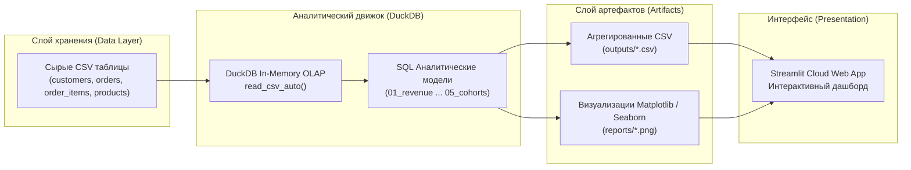

# Аналитика розничных продаж (Retail Analytics Portfolio)

[English Version](README.md) | **Русская версия**

[](https://github.com/lllexalllepexa/portfolio-retailmetrics/actions)
[](https://lllexalllepexa-test1.streamlit.app/)


---

### 🌐 Интерактивное демо (Live Demo)
[](https://lllexalllepexa-test1.streamlit.app/)

Интерактивный дашборд доступен онлайн: **[https://lllexalllepexa-test1.streamlit.app/](https://lllexalllepexa-test1.streamlit.app/)**

---

## 📌 Описание проекта и бизнес-задача

Комплексный аналитический проект полного цикла (end-to-end analytics engineering & data analysis) для анализа показателей многостраничного B2C e-commerce сервиса.

### Ключевые бизнес-вопросы:
1. **Динамика GMV и заказов**: какова траектория роста выручки от месяца к месяцу?
2. **Товарный микс**: какие категории продуктов формируют основной объем продаж и чистый доход с учетом возвратов?
3. **Географическое распределение и AOV**: как варьируется средний чек между рынками (US, GB, DE, FR, PL)?
4. **Когортный анализ удержания**: как клиенты, зарегистрированные в разные месяцы, продолжают совершать покупки на отрезке 0–3 месяцев (Month 0 to Month 3 retention)?

---

## 📈 Ключевые аналитические инсайты

- **Взрывной рост GMV**: Рост ежемесячного GMV в **~15 раз** — с **$24.6K** в январе 2024 до **$379.4K** в июне 2024 (суммарный GMV за полугодие превысил **$1.39M** при 2,102 заказах).
- **Лидеры категорий**: Категории **Books** ($347.9K) и **Sports** ($327.6K) лидируют по объему выручки, составляя почти половину совокупного GMV магазина.
- **Стабильность среднего чека (AOV)**: США (US) лидирует по общему объему (977 заказов, $653K GMV). При этом европейские рынки (GB: $678, FR: $656, DE: $649, PL: $641) демонстрируют высокую и однородную плотность среднего чека.
- **Динамика когортного удержания**: Апрельская когорта 2024 года показала пиковое удержание в первый месяц (**61.3%** в Month 1), при этом базовое удержание стабилизируется в диапазоне **35–45%** на интервале M1–M3.

---

## 🏗️ Архитектура и поток данных



---

## 📊 Визуализации

### Когортный анализ удержания (Cohort Retention Heatmap)


### Динамика GMV по месяцам


### Структура GMV по категориям товаров


---

## 📁 Структура проекта

```text
portfolio-retailmetrics-audit/
├── data/                       # Сырые исходные CSV-таблицы (seed dataset)
│   ├── customers.csv
│   ├── orders.csv
│   ├── order_items.csv
│   └── products.csv
├── sql/                        # Аналитические SQL-модели для DuckDB
│   ├── 01_revenue_by_month.sql
│   ├── 02_revenue_by_category.sql
│   ├── 03_country_orders_aov.sql
│   ├── 04_top_products.sql
│   └── 05_cohort_retention.sql
├── src/
│   └── run_pipeline.py         # Основной оркестратор: DuckDB загрузка, SQL выполнение, экспорт
├── scripts/
│   ├── generate_data.py        # Детерминированный генератор синтетических данных (seed=42)
│   └── plot_cohort_heatmap.py  # Скрипт визуализации тепловой карты когорт
├── tests/
│   └── test_pipeline_and_data.py # Автотесты Pytest для валидации данных и конвейера
├── outputs/                    # CSV-отчеты работы пайплайна
├── reports/                    # Сгенерированные графики и диаграммы (PNG)
├── streamlit_app.py            # Интерактивное веб-приложение Streamlit
├── requirements.txt            # Зависимости Python
└── README.md                   # Документация проекта
```

---

## 🗄️ Каталог SQL-запросов

| Запрос | Файл | Описание и логика |
|---|---|---|
| **01** | [`01_revenue_by_month.sql`](sql/01_revenue_by_month.sql) | Ежемесячный валовый доход (GMV) и количество выполненных заказов. Исключает отмененные заказы (`cancelled`), учитывает частичные возвраты товаров. |
| **02** | [`02_revenue_by_category.sql`](sql/02_revenue_by_category.sql) | Структура выручки и количество проданных единиц (net units) в разрезе продуктовых категорий. |
| **03** | [`03_country_orders_aov.sql`](sql/03_country_orders_aov.sql) | Анализ регионального микса: количество заказов, общий GMV и средний чек (AOV = GMV / orders) по странам. |
| **04** | [`04_top_products.sql`](sql/04_top_products.sql) | Топ-15 продуктов с наибольшей совокупной чистой выручкой. |
| **05** | [`05_cohort_retention.sql`](sql/05_cohort_retention.sql) | Когортный анализ удержания по месяцу первой регистрации (signup month) со смещениями Month 0..3 с использованием оконных функций и CTE. |

---

## 📐 Методология расчета ключевых метрик

- **GMV (Gross Merchandise Value)**: $\sum (\text{quantity} - \text{quantity\_returned}) \times \text{unit\_price\_paid}$ для строк со статусом `completed` или `returned`. Заказы со статусом `cancelled` исключаются.
- **AOV (Average Order Value)**: Отношение суммарного GMV к общему числу уникальных оплаченных заказов в соответствующем сегменте.
- **Когорта (Cohort Month)**: Календарный месяц регистрации клиента (`signup_date`).
- **Retention Rate**: Доля клиентов когорты, совершивших хотя бы один квалифицирующий заказ в месяц `signup_month + n` (где $n \in [0, 3]$).

---

## 🚀 Быстрый старт

### 1. Клонирование и подготовка окружения
```bash
git clone https://github.com/lllexalllepexa/portfolio-retailmetrics.git
cd portfolio-retailmetrics

# Создание и активация виртуального окружения
python -m venv .venv
# Windows (PowerShell):
.venv\Scripts\Activate.ps1
# Linux / macOS:
source .venv/bin/activate

# Установка зависимостей
pip install -r requirements.txt
```

### 2. Запуск аналитического конвейера
```bash
# Выполняет загрузку в DuckDB, исполнение всех SQL и сохранение отчетов
python src/run_pipeline.py
```

### 3. Запуск локального дашборда Streamlit
```bash
streamlit run streamlit_app.py
```

### 4. Генерация свежего датасета (опционально)
```bash
python scripts/generate_data.py
python src/run_pipeline.py
```

### 5. Запуск тестов
```bash
pytest -v
```

---

## 🛠️ Стек технологий

- **Ядро аналитики**: SQL (DuckDB OLAP engine)
- **Язык разработки**: Python 3.11+
- **Обработка данных**: Pandas, NumPy
- **Визуализация**: Matplotlib, Seaborn
- **Веб-интерфейс**: Streamlit Cloud
- **Тестирование & CI**: Pytest, GitHub Actions CI
