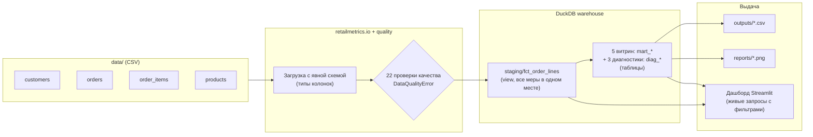

# Retail Metrics: аналитика продаж и когорт

> Небольшой end-to-end проект по analytics engineering: сырые CSV → загрузка в DuckDB с явной схемой → проверки качества данных → staging-модель фактов → пять SQL-витрин → графики и интерактивный дашборд Streamlit, с тестами на эталонных данных и проверкой одной командой.

[English version](README.md) | **Русская версия** · **[Живой дашборд](https://lllexalllepexa-test1.streamlit.app/)** (без посетителей засыпает, первая загрузка может занять около минуты)


[](https://lllexalllepexa-test1.streamlit.app/)


> [!IMPORTANT]
> **Все данные синтетические.** Их создаёт [`scripts/generate_data.py`](scripts/generate_data.py) (seed 42) из намеренно простых распределений. Цифры ниже демонстрируют работу пайплайна и определения метрик, а не выводы о реальных клиентах. Часть видимых трендов — артефакты генератора, см. раздел [«Диагностика синтетических артефактов»](#диагностика-синтетических-артефактов).

---

## Бизнес-вопросы

Сценарий: B2C-магазин, пять рынков (US, GB, DE, FR, PL), январь–июнь 2024.

1. **Рост** — как меняется месячная чистая выручка и что его определяет: число заказов или средний чек?
2. **Категории** — какие категории дают больше всего чистой выручки после возвратов и где концентрируются возвраты?
3. **Рынки** — отличается ли средний чек (AOV) между странами?
4. **Удержание** — какая доля клиентов покупает снова в месяцы после первой покупки?

## Результаты на синтетических данных

| Область | Результат | Учитывать |
|---|---|---|
| Итоги (H1 2024) | **$1 448 429,39 чистой выручки** при $1 546 683,95 валовой (возвраты — 6,35% по стоимости); 2 171 квалифицирующий заказ от 1 027 покупателей; 116 отменённых заказов исключены | — |
| Рост | Чистая выручка растёт с $34,1K (январь, 60 заказов) до $402,1K (июнь, 582 заказа), ~11,8x | [Артефакт 1](#1-рост--это-накопленная-клиентская-база-а-не-импульс) |
| Категории | Books ($362,2K) и Sports ($321,7K) — 47,2% чистой выручки; доля возвратов от 5,2% (Apparel) до 7,2% (Books) | Товары выбираются равномерно случайно, так что рейтинг отражает случайные цены |
| Рынки | AOV (чистая выручка / оплаченные заказы): FR $726, PL $718, GB $709, US $690, DE $684 — **95% доверительные интервалы всех стран пересекаются** (±$30–67, [`country_aov_ci.csv`](outputs/diagnostics/country_aov_ci.csv)) | [Артефакт 3](#3-разница-aov-между-странами--это-шум) |
| Удержание | Удержание в Month 1: январская когорта 25,9% (95% ДИ 16–39%, n = 54), февраль 31,5%, март 28,6%, **апрель 40,8% (35–47%)**, май 39,7% | [Артефакт 2](#2-поздние-когорты-выглядят-лояльнее-потому-что-их-заказы-сжаты-во-времени) |

Точные значения — в [`outputs/`](outputs/), и каждое число в этом README, включая диагностику ниже, получено закоммиченным запросом. Тесты пересчитывают все выгрузки с нуля и падают, если они расходятся с закоммиченными файлами.

### Графики


| | |
|---|---|
|  |  |

---

## Диагностика синтетических артефактов

Дашборд покажет любой паттерн во входных данных. Прежде чем объяснять тренд поведением клиентов, стоит проверить, не порождает ли его сам процесс генерации данных. Здесь — порождает, причём для трёх самых «эффектных» результатов.

**Как устроен генератор:** 1 200 клиентов регистрируются равномерно с 1 января по **30 апреля**. Каждый клиент независимо получает **0–5 заказов (в среднем ≈ 1,8)** с датами, равномерно распределёнными между регистрацией и **30 июня**. Страна, товары, скидки и статусы выбираются независимо от всего остального.

### 1. Рост — это накопленная клиентская база, а не импульс

Источник: [`sql/diagnostics/monthly_activity.sql`](sql/diagnostics/monthly_activity.sql) → [`outputs/diagnostics/monthly_activity.csv`](outputs/diagnostics/monthly_activity.csv)

| Месяц | Новых регистраций | Накопленно | Активных покупателей | Заказов | Чистая выручка / заказ |
|---|---:|---:|---:|---:|---:|
| 2024-01 | 295 | 295 | 54 | 60 | $568 |
| 2024-02 | 288 | 583 | 125 | 138 | $655 |
| 2024-03 | 324 | 907 | 267 | 319 | $676 |
| 2024-04 | 293 | 1 200 | 368 | 468 | $661 |
| 2024-05 | 0 | 1 200 | 467 | 604 | $658 |
| 2024-06 | 0 | 1 200 | 450 | 582 | $691 |

Выручка на заказ стабильна; весь рост — это объём заказов, а объём следует за числом уже зарегистрированных клиентов, у которых ещё «остались» заказы. Плато в мае–июне — это просто момент, когда прекращаются регистрации. Спрос, маркетинг или операционная деятельность в данных никак не закодированы, поэтому делать о них выводы нельзя.

### 2. Поздние когорты выглядят лояльнее, потому что их заказы сжаты во времени

Распределение числа заказов одинаково для всех клиентов, независимо от того, сколько времени осталось до конца окна ([`sql/diagnostics/signup_cohorts.sql`](sql/diagnostics/signup_cohorts.sql)):

| Месяц регистрации | Клиентов | Ср. дней до 30 июня | Неотменённых заказов / клиент |
|---|---:|---:|---:|
| 2024-01 | 295 | 165 | 1,94 |
| 2024-02 | 288 | 136 | 1,78 |
| 2024-03 | 324 | 106 | 1,69 |
| 2024-04 | 293 | 76 | 1,84 |

Апрельский клиент размещает ~1,8 заказа за ~2,5 месяца, январский — те же ~1,8 заказа за ~5,5 месяца. Если упаковать одинаковое число заказов в меньшее число месяцев, доля клиентов, активных в каждом месяце, механически растёт — именно это и видно в ячейках Month 1 для апреля (40,8%) и мая (39,7%). Январская ячейка при этом наименее надёжна: при n = 54 её 95% интервал — 16–39%. Тот же механизм объясняет, почему январская когорта по первой покупке мала (n = 54): у большинства январских регистраций первый заказ приходится на более поздний месяц.

В реальных данных такой рост стал бы поводом изучить каналы привлечения или изменения в онбординге. Здесь правильный вывод — «поведенческого сигнала нет».

### 3. Разница AOV между странами — это шум

Страна назначается независимо от содержимого корзины, поэтому любая разница в AOV — выборочный шум. Данные это подтверждают: при n = 201–924 оплаченных заказов на страну 95% доверительные интервалы (±$30–67) пересекаются для любой пары стран ([`sql/diagnostics/country_aov_ci.sql`](sql/diagnostics/country_aov_ci.sql)). Утверждение «у FR самый высокий AOV» было бы переинтерпретацией.

### Что нужно более реалистичному генератору

Число заказов, зависящее от срока жизни клиента; затухающая вероятность повторной покупки (отток); сезонность; размер корзины, зависящий от страны или канала. Тогда тот же пайплайн и те же тесты выявляли бы реальную структуру, а не артефакты.

---

## Архитектура



- **Бизнес-логика в одном месте.** Все меры выручки (`gross_revenue`, `returned_revenue`, `net_revenue`, `discount_amount`, `quantity_net`) и фильтр квалифицирующих статусов определены в [`sql/staging/fct_order_lines.sql`](sql/staging/fct_order_lines.sql). Витрины агрегируют эту модель, дашборд запрашивает её с фильтрами.
- **Ранняя остановка.** Сырые файлы загружаются с заданными типами и проверкой заголовков и валидируются до запуска моделей. Все упавшие проверки выводятся вместе.
- **Явный DAG.** Модели выполняются в порядке, объявленном в [`retailmetrics/models.py`](retailmetrics/models.py); витрины материализуются как таблицы `mart_*` в `warehouse.duckdb`.

## SQL-модели (диалект DuckDB SQL)

| Модель | Гранулярность / назначение | Ключевые колонки |
|---|---|---|
| [`staging/fct_order_lines`](sql/staging/fct_order_lines.sql) | Строка заказа со статусом completed или returned | `gross_revenue`, `returned_revenue`, `net_revenue`, `discount_amount`, `quantity_net` |
| [`01_revenue_by_month`](sql/01_revenue_by_month.sql) | Месяц | `gross_revenue_usd`, `net_revenue_usd`, `return_rate`, `order_count` |
| [`02_revenue_by_category`](sql/02_revenue_by_category.sql) | Категория | `gross_revenue_usd`, `net_revenue_usd`, `return_rate`, `units_sold_net` (BIGINT) |
| [`03_country_orders_aov`](sql/03_country_orders_aov.sql) | Страна | `orders`, `paid_orders`, `net_revenue_usd`, `aov_usd` |
| [`04_top_products`](sql/04_top_products.sql) | Товар (топ-15) | `net_revenue_usd`, `return_rate`, `units_sold_net` |
| [`05_cohort_retention`](sql/05_cohort_retention.sql) | Когорта × смещение 0–3 месяца | `cohort_customers`, `active_customers`, `retention_rate`, `retention_ci_low`, `retention_ci_high` |
| [`diagnostics/country_aov_ci`](sql/diagnostics/country_aov_ci.sql) | Страна | `paid_orders`, `aov_usd`, `ci_low_usd`, `ci_high_usd` |
| [`diagnostics/monthly_activity`](sql/diagnostics/monthly_activity.sql) | Месяц | `new_signups`, `cumulative_signups`, `active_buyers`, `orders`, `net_revenue_per_order_usd` |
| [`diagnostics/signup_cohorts`](sql/diagnostics/signup_cohorts.sql) | Месяц регистрации | `customers`, `avg_days_left`, `non_cancelled_orders_per_customer` |

Запросы используют функции, специфичные для DuckDB (`strftime`, `date_trunc`, `date_diff`, `range`, `to_months`, `FILTER`, `ANTI JOIN`).

## Определения метрик

| Метрика | Определение |
|---|---|
| Квалифицирующий заказ | Статус `completed` или `returned`. Заказы `cancelled` исключаются везде. |
| Валовая выручка | Σ количество × уплаченная цена (после скидки, до возвратов) |
| Чистая выручка | Σ (количество − возвращено) × уплаченная цена |
| Доля возвратов | Возвращённая выручка / валовая выручка |
| Сумма скидок | Σ количество × (прайсовая цена − уплаченная цена) |
| Заказы | Число квалифицирующих заказов, включая полностью возвращённые |
| Оплаченные заказы | Квалифицирующие заказы с чистой выручкой > 0 |
| AOV | Чистая выручка / оплаченные заказы (полностью возвращённые не занижают показатель). KPI на дашборде считается так же. |
| Месяц когорты | Календарный месяц **первого квалифицирующего заказа** клиента. Полностью возвращённый заказ тоже считается покупкой: у 44 из 1 027 клиентов (4,3%) когорта построена по такому заказу. Более строгий вариант — первый заказ с чистой выручкой > 0. |
| Удержание (c, n) | Доля когорты c, сделавшей ≥ 1 квалифицирующий заказ в месяце c + n. Month 0 = 100% по определению. Ячейки без активности показываются как 0%; ячейки после последнего месяца данных цензурированы справа и не выводятся. Для каждой ячейки считается 95% интервал Уилсона. |

> Термин «GMV» сознательно не используется: обычно он означает валовую стоимость до возвратов, а большинство витрин здесь показывает чистую выручку.

## Качество данных

[`retailmetrics/quality.py`](retailmetrics/quality.py) выполняет 22 SQL-проверки до построения моделей и выбрасывает `DataQualityError` со списком всех нарушений:

- первичные ключи: не NULL, уникальны (все четыре таблицы)
- внешние ключи: не NULL, без «сирот» (orders → customers, order_items → orders, order_items → products)
- бизнес-правила: допустимые статусы; `order_date ≥ signup_date`; у каждого заказа есть строки; quantity > 0; неотрицательные цены; `0 ≤ quantity_returned ≤ quantity`; возвраты только в заказах со статусом returned; в каждом возвращённом заказе возвращена хотя бы одна единица

Последнее правило поймало реальную ошибку исходного генератора (возвращённые заказы без возвращённых товаров); она исправлена.

## Тестирование

Одна команда запускает линтер Ruff, проверку форматирования и полный набор тестов pytest:

```bash
python scripts/check.py
```

Этот же скрипт автоматически запускается перед каждым коммитом через хук [pre-commit](https://pre-commit.com/) (один раз после установки: `pre-commit install`). Облачный CI для этого аккаунта GitHub недоступен, поэтому workflow в [`.github/workflows/ci.yml`](.github/workflows/ci.yml) запускается только вручную (`workflow_dispatch`) и вызывает тот же скрипт.

| Набор | Что проверяет |
|---|---|
| [`tests/test_metrics.py`](tests/test_metrics.py) | Точные значения метрик на эталонных данных, посчитанных вручную (2 клиента, 4 заказа, включая частичный возврат и отмену): чистая и валовая выручка, исключение отменённых, целочисленные единицы, знаменатель AOV, привязка когорт к первой покупке, Month 0 = 1.0, нулевые ячейки, цензурирование, интервалы Уилсона, диагностические запросы |
| [`tests/test_quality.py`](tests/test_quality.py) | Каждая проверка качества срабатывает на внесённом дефекте; несовпадение схемы и отсутствующие файлы отклоняются |
| [`tests/test_pipeline_and_data.py`](tests/test_pipeline_and_data.py) | Детерминированность генератора и логика возвратов; полный прогон пайплайна; сходимость чистой выручки между витринами; диагностика сходится с витринами; закоммиченные `data/` и `outputs/` совпадают со свежей регенерацией |
| [`tests/test_streamlit_app.py`](tests/test_streamlit_app.py) | Дашборд отрисовывается; KPI реагируют на фильтр по стране; AOV не учитывает полностью возвращённые заказы; цензурированные ячейки когорт остаются пустыми |

Все тесты пишут только во временные каталоги pytest: рабочее дерево не изменяется, порядок запуска не важен.

## Быстрый старт

Нужен Python 3.11+.

```bash
git clone https://github.com/lllexalllepexa/portfolio-retailmetrics.git
cd portfolio-retailmetrics
python -m venv .venv
source .venv/bin/activate          # Windows PowerShell: .venv\Scripts\Activate.ps1
pip install -r requirements-dev.txt
pre-commit install                 # проверки перед каждым коммитом
```

```bash
python -m retailmetrics.pipeline   # warehouse.duckdb, outputs/*.csv, reports/*.png
streamlit run streamlit_app.py     # http://localhost:8501 (при старте собирает хранилище в памяти из data/)
python scripts/check.py            # ruff + все тесты
```

Регенерация синтетических данных (детерминированно, seed 42):

```bash
python scripts/generate_data.py
python -m retailmetrics.pipeline
```

## Структура репозитория

```text
portfolio-retailmetrics/
├── data/                         # Сырые синтетические CSV (в репозитории, воспроизводимы)
├── outputs/                      # Выгрузки витрин + diagnostics/ (в репозитории, тесты сверяют их с регенерацией)
├── reports/                      # Графики и скриншот дашборда для README
├── retailmetrics/                # Пакет пайплайна
│   ├── config.py                 #   пути
│   ├── io.py                     #   загрузка CSV с явной схемой
│   ├── quality.py                #   проверки качества данных
│   ├── models.py                 #   DAG staging + витрины
│   ├── charts.py                 #   статичные графики
│   └── pipeline.py               #   точка входа CLI
├── scripts/
│   ├── generate_data.py          # Генератор синтетических данных
│   └── check.py                  # Линтер + тесты (локальный CI, используется pre-commit)
├── sql/
│   ├── staging/fct_order_lines.sql
│   ├── diagnostics/              # Запросы для раздела «Диагностика синтетических артефактов»
│   └── 01_… – 05_….sql           # Витрины
├── tests/                        # Эталонные данные, качество, end-to-end, дашборд
├── streamlit_app.py              # Дашборд
├── pyproject.toml                # Конфигурация пакета, pytest и ruff
├── requirements.txt              # Зафиксированные runtime-зависимости (для Streamlit Cloud)
└── requirements-dev.txt          # + pytest, ruff
```

## Стек

DuckDB 1.5 · Python 3.11 · pandas · Matplotlib / Seaborn · Streamlit · pytest · Ruff · pre-commit
